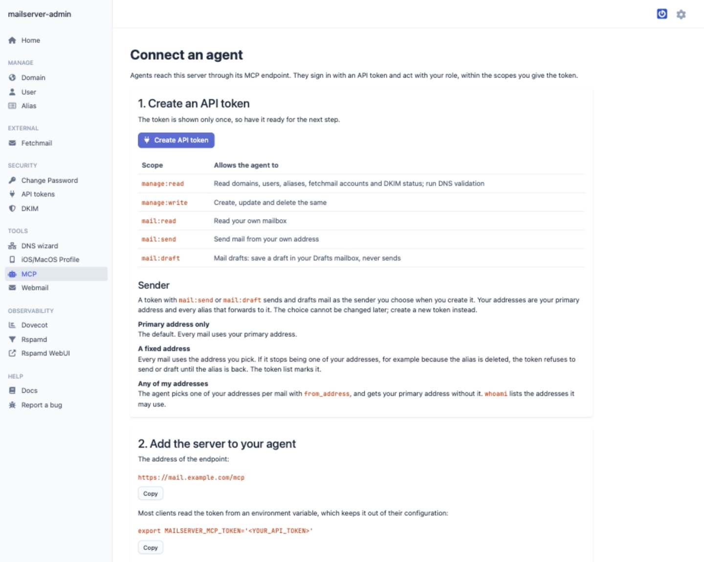
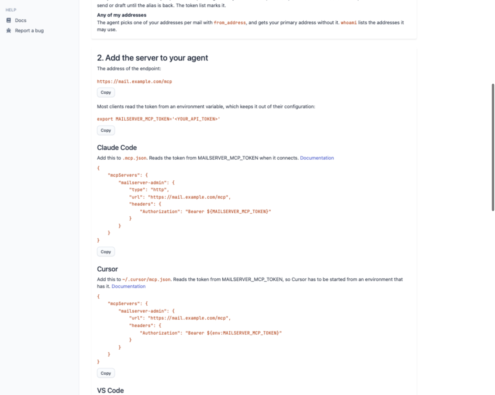
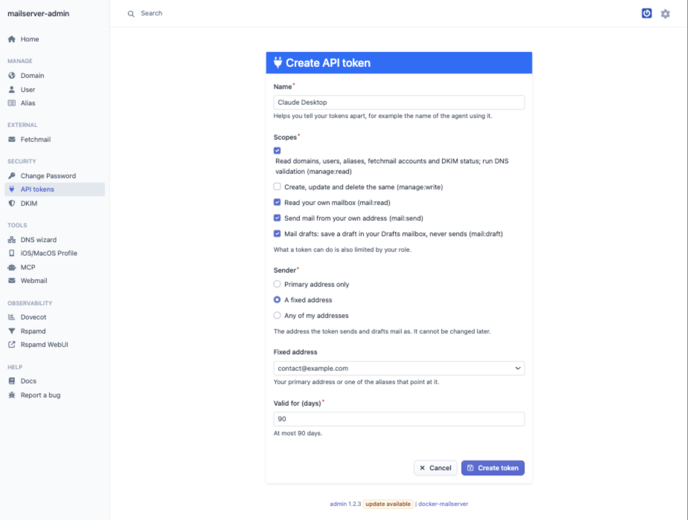
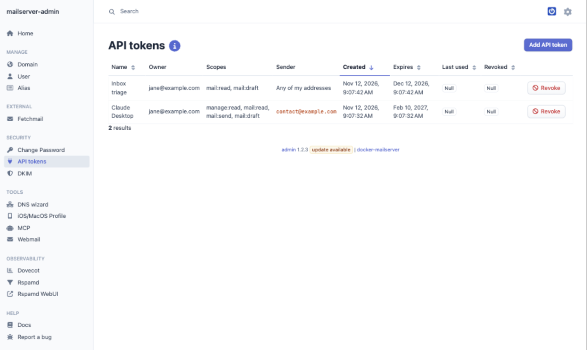

# mailserver-admin

## Description

This is an administration interface for [docker-mailserver](https://github.com/jeboehm/docker-mailserver). It provides a web-based interface
to manage mail domains, users, aliases, and DKIM settings. The interface is built using Symfony + EasyAdminBundle and integrates with OAuth2 for
authentication.

### Features:

- **Domain Management**: Add, edit, and delete mail domains.
- **User Management**: Create, update, and remove mail users. Set passwords and manage user details.
- **Alias Management**: Define mail aliases to forward emails to different addresses.
- **DKIM Management**: Configure DKIM settings for domains to ensure email authenticity.
- **Fetchmail Configuration**: Set up and manage Fetchmail to retrieve emails from external servers.
- **OAuth2 Integration**: Secure the interface with OAuth2 authentication, allowing you to use your existing OAuth2 provider for login.
- **DNS Setup Wizard**: A wizard to help you set up your DNS records for your mail server.
- **iOS/MacOS Profile**: Generates iOS/macOS email profiles for your mail server.
- **Observability**: Monitoring and statistics for Dovecot and Rspamd services.
- **MCP Server**: Connect AI agents such as Claude Code, Cursor, VS Code or Codex through the Model Context Protocol. Agents act with your role,
  within the scopes of their token: manage domains, users and aliases, read your mailbox, save drafts and send mail.
- **API Tokens**: Create, list and revoke the tokens agents sign in with. Each token has its own scopes, lifetime and sender: your primary
  address, a fixed address, or any of your addresses.

## Documentation

You can find the documentation for `mailserver-admin` in the [docker-mailserver documentation](https://jeboehm.github.io/docker-mailserver/).

- [Development](https://jeboehm.github.io/docker-mailserver/development/mailserver-admin/)
- [Configuration](https://jeboehm.github.io/docker-mailserver/configuration/mailserver-admin/)
- Administration:
  - [Dashboard](https://jeboehm.github.io/docker-mailserver/administration/dashboard/)
  - [Domain](https://jeboehm.github.io/docker-mailserver/administration/manage-domains/)
  - etc.

## Screenshots

### Dashboard

### Domain

### DNS Validation Wizard

### Observability

### MCP: Connect an agent

### API Tokens

